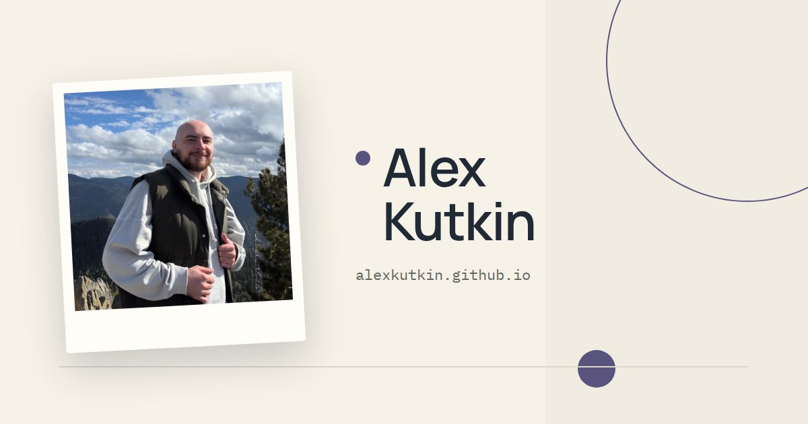

# Alex Kutkin's site

A personal site, static and bilingual: a blog of notes and a CV page.

[](LICENSE)

Live site: <https://alexkutkin.github.io/>



## Overview

Two languages ship every page. English is the default and Russian is the
alternative, with the language in the URL: `/en/` and `/ru/`. The home page
lists notes with pagination, each note has its own article page, and the CV is
Markdown in the same layout. RSS publishes the full note text per language.

## Features

- **Bilingual routes.** The root `/` redirects to the saved locale, or to the
  browser language on a first visit. `/en/` and `/ru/` open directly and never
  redirect.
- **Notes.** Markdown articles with images, code, wide tables, and Mermaid
  diagrams. Ten notes per page, newest first.
- **CV.** One Markdown page per language under a localized header label.
- **Themes.** System, light, and dark. The choice persists and applies before
  the page paints.
- **Mermaid diagrams.** Rendered in the article body, with the diagram source
  kept as the fallback when rendering fails.
- **Living dot.** The header mark is a small animated dot.

## Getting started

You need Node and npm.

```sh
npm install
npm run dev
```

The dev server listens on the local network at port 4321. For a phone on the
same Wi-Fi network, open `http://<computer-LAN-IP>:4321/ru/` or `/en/`. Use the
computer's LAN IPv4 address, `localhost` on the phone reaches the phone itself.

## Commands

| Command | Does |
| --- | --- |
| `npm run dev` | Starts the dev server on port 4321 |
| `npm run build` | Builds the static site into `dist/` |
| `npm run preview` | Serves the latest build |
| `npm run typecheck` | Runs `astro sync` and `tsc --noEmit` |

> [!NOTE]
> `astro build` does not check types. Run `npm run typecheck` after code
> changes.

## Layout

| Path | What it holds |
| --- | --- |
| `src/content` | Published notes and CV, one folder per language |
| `src/pages` | Routes per locale, RSS feeds, the 404 page |
| `src/components` | Header, footer, views, theme and language switches |
| `src/styles` | Design tokens, layout primitives, page styles |
| `tests/fixtures` | Demonstration notes used only by the checks |
| `scripts` | Content checks and the browser harness |

## Content

Published notes live in `src/content`. Demonstration posts live in
`tests/fixtures/articles` and never reach the build. After content changes,
prove the split:

```sh
npm run build
node scripts/verify-public-content.mjs
```

## Verification

From Git Bash, `node scripts/verify.mjs --suite site --port 4330` builds the
site and drives it through Chromium in the existing `playwright-sandbox-1`
container. It covers both locales, pagination, articles, the CV, RSS, themes,
keyboard focus, Mermaid, and mobile widths from 320 to 430 CSS pixels. Evidence
lands in `artifacts/verification/<run-id>/`, which Git ignores.

Read [the verification map](.agents/skills/verify-personal-site/features/README.md)
before changing the harness.

## Stack

Astro 7, Markdown content collections, plain CSS with custom properties, and
TypeScript in the scripts.

## License

MIT. See [LICENSE](LICENSE).
