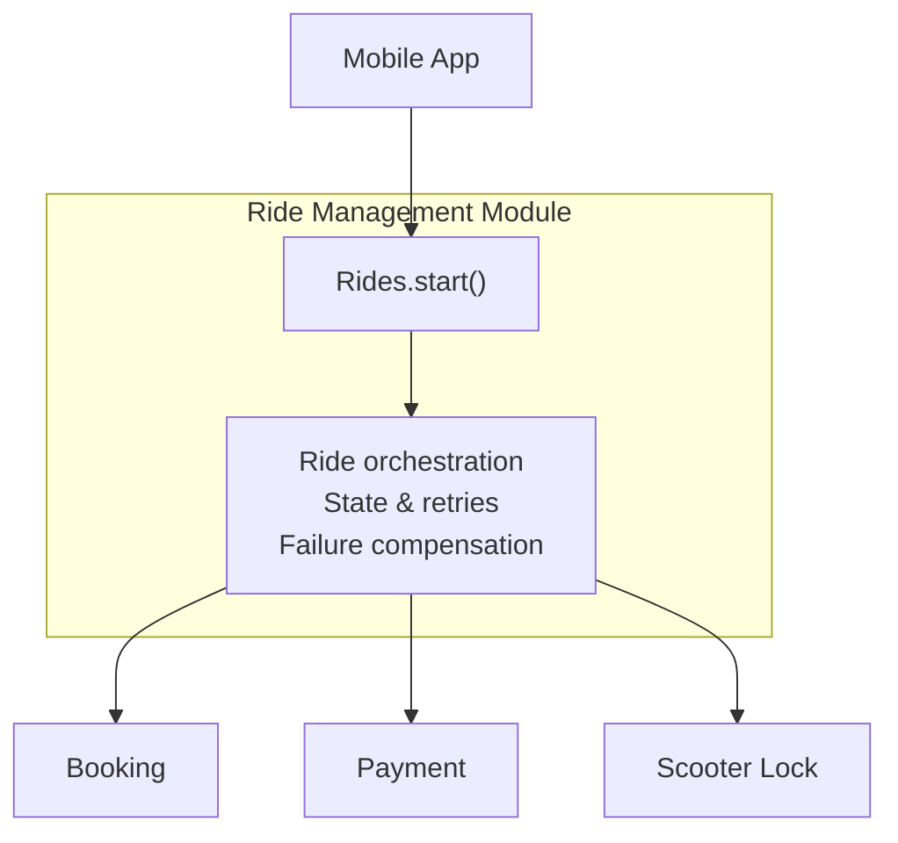

It's fairly easy to agree with coding agents on what needs to be built. Agreeing on how the software itself should be structured is a different story.

For example, I might ask an agent to design a system that's easy to extend. But what exactly do I mean by extensibility? The ability to replace individual components? Change business logic? Scale parts of the system independently? Maybe all of the above?

The agent will certainly come up with something. The question is how closely its idea of good architecture matches mine.

As more and more code gets written by agents, I think **expressing engineering intent** is becoming a skill in its own right.

And for that, we need something between natural language, with all its ambiguity, and concrete architectural decisions. Some kind of intermediate language that lets us describe the properties we want from a system without having to design every last detail ourselves.

## One Skill Caught My Eye

I've been following Matt Pocock's work for a while, and one of his skills particularly caught my attention: [codebase-design](https://www.skills.sh/mattpocock/skills/codebase-design). It's essentially a small vocabulary of architectural concepts for communicating with agents.

The concepts themselves are nothing new. What's interesting is the idea of bringing them together into a shared vocabulary that both humans and agents can use.

Let's try an example.

Suppose we're designing an electric scooter rental service. To start a ride, we need to reserve a scooter, authorize a payment, and unlock it. Each operation is handled by a separate system.

On a presentation slide, everything looks wonderful: three boxes, a few arrows. You could even draw a little cloud.

Then a customer taps "Start ride." The payment goes through, the lock opens, but the scooter's response gets lost somewhere on the network. The app thinks the ride never started. Meanwhile, the customer is already halfway down the street.

And that's still one of the better outcomes.

This is where I'd like to have a conversation with the agent about architecture.

## How Deep Should a Module Be?

Pocock uses the term **module** for a part of a system that has its own **interface** and **implementation**.

A module doesn't have to be a function or a class. It can span an entire part of a distributed system. And its interface includes more than just methods: it also covers behavioral guarantees.

Then there's **depth**. A good, deep module provides a lot of useful behavior through a relatively small interface.

In our case, I'd like the app to need just one call:

```javascript
await rides.start({
  userId,
  scooterId,
  requestId
});
```

Here, `requestId` helps the server distinguish a retry of the same request from a new attempt to start a ride, preventing duplicate operations.

Coordination between independent systems, failure handling, and duplicate prevention should all remain hidden inside the module.



Of course, the call itself doesn't guarantee that the lock has opened. It might return a ride ID and an intermediate status. That's part of the contract too.

This design gives us two useful properties.

**Leverage** is how much capability we get from learning an interface. **Locality** is how well changes stay contained. If we change the retry logic tomorrow, I'd rather not have to update the mobile app and every other consumer.

But that tells us what makes a good module. How do we know whether we need the module at all?

Pocock offers a useful thought experiment: the *deletion test*. Imagine removing the module while preserving the system's functionality. If the complexity it was hiding spreads throughout the rest of the codebase, the module was doing something useful. If all that disappears is an extra layer of indirection, perhaps we didn't need it in the first place.

And a deep module doesn't have to be some enormous service that knows everything about everything. I prefer building it from smaller, independently composable parts. Depth is a property of the external interface, not the internal structure.

## What If Another Manufacturer Shows Up Tomorrow?

Two more concepts come in handy here: **seam** and **adapter**.

A *seam* is a place where we can change behavior without modifying the code that uses it. An adapter is a concrete implementation plugged in at that seam.

Suppose we add scooters from another manufacturer to our fleet. Their locks use a completely different communication protocol.

I don't want the ride management system to know or care about that. So we need a seam between the ride logic and the hardware, allowing different adapters to be plugged in.

But if there's only one implementation and no actual need to swap it out, adding another seam might be completely unnecessary.

That's something I like about this vocabulary. It lets us discuss not only which abstractions to introduce, but whether they're justified at all.

## I Talk to the Agent

Now I can describe the task something like this:

> I want a deep ride management module with a minimal external interface. Coordination of distributed operations and failure handling should remain internal. Repeated requests must not cause duplicate charges or create multiple rides. Internal parts should remain compositionally independent. Introduce seams where replaceability is actually needed, and explain the architectural trade-offs.

Of course, that instruction alone won't magically produce a perfect architecture.

But here's an important difference from how we traditionally design software. I don't necessarily have to choose specific patterns, define the component structure, or work out the sequence of calls in advance. The agent can propose an architecture itself, perhaps using distributed operation orchestration and compensating actions, and I can evaluate how well those decisions reflect my original intent.

## The Agent Talks Back

And this language works both ways. The agent can use the same concepts to explain its architecture to me, rather than walking me through dozens of files.

For example:

> I've hidden the coordination of distributed operations behind the ride management interface. I chose a sequence of local operations with compensating actions for failures. I introduced a separate seam for different lock manufacturers. I didn't add extra interfaces for state management, since that's currently an internal part of the module that doesn't need to be replaced independently.

I already understand the general shape of the solution. More importantly, I can discuss the trade-offs with the agent before diving into the implementation.

In a sense, this also lets us abstract away from the technology stack. The same architectural problem might be solved very differently in TypeScript, Go, or Python. But the underlying ideas are often the same: hiding complexity, keeping changes local, and making implementations replaceable.

So the shared vocabulary works in both directions. **I express my intent, the agent translates it into architecture, and then explains the result using the same language.**

That two-way conversation is what I find particularly interesting.

## A Few Final Thoughts

None of these ideas are new, of course. John Ousterhout wrote extensively about deep modules, and Michael Feathers introduced the concept of seams. Developers have been using these ideas to discuss architecture with one another for years.

But with coding agents, this vocabulary takes on a new role.

Previously, we had to make the entire journey from architectural intent to concrete implementation ourselves. Now an agent can handle a substantial part of that journey. A shared vocabulary lets us guide the process at a higher level of abstraction without losing the ability to question and discuss its decisions.

Of course, `codebase-design` is hardly a full-fledged modeling language. But I think vocabularies like this are early steps toward one.

Perhaps, eventually, we'll be able to describe an architecture through a set of sufficiently precise concepts, constraints, and relationships. And agents will be able to find implementations that satisfy those requirements, regardless of the underlying technologies.

There's just one problem.

An agent can speak very convincingly about module depth and well-placed seams, then go on to produce an absolutely monstrous architecture. And explain it using exactly the same beautiful words.

**A shared language lets us express intent. It doesn't prove that the implementation actually matches it.**

Which brings us to the next question: how do we verify architectural decisions?

But that's a topic for another article.

---

### References

1. **Matt Pocock** — [Codebase Design](https://github.com/mattpocock/skills/blob/main/docs/engineering/codebase-design.md). Architectural vocabulary and principles for designing deep modules. The skill is also available on [skills.sh](https://www.skills.sh/mattpocock/skills/codebase-design).
2. **John Ousterhout** — [A Philosophy of Software Design](https://web.stanford.edu/~ouster/cgi-bin/book.php), 2nd edition, 2021. Module depth and managing complexity.
3. **Michael Feathers** — *Working Effectively with Legacy Code*, 2004. The concept of seams. See also [Martin Fowler's explanation](https://martinfowler.com/bliki/LegacySeam.html).
4. **Chris Richardson** — [Pattern: Saga](https://microservices.io/patterns/data/saga.html). Coordinating distributed operations and handling failures through compensating actions.
