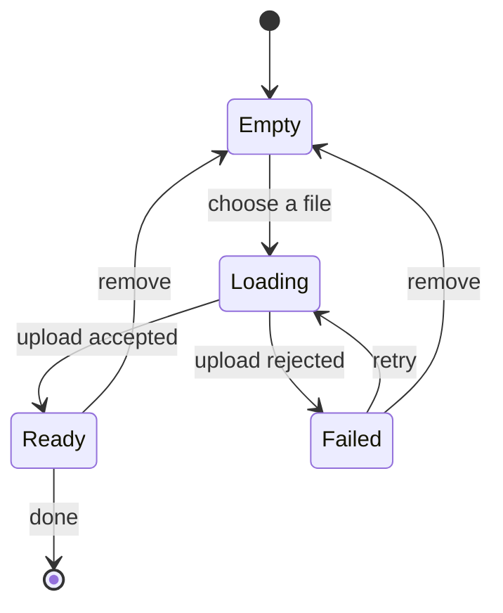

The first draft of a feature is rarely code. It is a short description of the states: empty, loading, ready, failed. Once those have names, the code has somewhere to go.

A model is useful when it answers three questions: **what can happen**, **who is allowed to make it happen**, and **what the user sees** when it does. Everything else is detail.

## Start with the states, not the screens

Screens are a consequence. A form that uploads a file has the same model whether it lives in a dialog, a page, or a command line. The interesting part is that a file can be *missing*, *uploading*, *uploaded*, or *rejected*, and the interface has to say which one is true.

Write the states down before naming any component:

- **Empty** — nothing has been chosen yet.
- **Loading** — the system is waiting for an answer.
- **Ready** — the answer arrived and can be used.
- **Failed** — the answer arrived, but it is not usable.

Four lines are enough for most features. If the list keeps growing, the feature is probably doing more than one job.

### One state, one meaning

A state is not a mood. `Loading` cannot also mean "saving" or "refreshing"; those are different promises. When two meanings share a name, every condition around them becomes a guess.

## The model is a contract

Each state needs an owner. The owner is not necessarily a person: it can be a request, a timer, or a background job. What matters is that the model says who may move the system from one state to another.

| State | What it means | Who enters it | What the user sees |
| --- | --- | --- | --- |
| `empty` | No input yet | The user | A call to action |
| `loading` | Waiting for a result | The user or the app | A progress message |
| `ready` | A usable result | The server | The result and the next step |
| `failed` | A result that cannot be used | The server or the network | A reason and a way back |

The table is not documentation for its own sake. It is the shortest form that exposes gaps: a row with no owner, a state nobody leaves, a message that promises something the code cannot deliver.

## Draw the transitions

A diagram earns its place when the transitions matter more than the states. For a small feature, a list is enough. For anything with retries, cancellation, or parallel requests, draw the [state machine](https://en.wikipedia.org/wiki/Finite-state_machine) before writing the handlers:



Every arrow is a promise. If an arrow has no label, the model is incomplete. If it has no owner, the code will invent one.

## Name the events before the handlers

Events are the vocabulary of the model. Keep them in the past tense and make them specific:

1. `fileSelected`
2. `uploadStarted`
3. `uploadAccepted`
4. `uploadRejected`
5. `fileRemoved`

Then add the conditions that are easy to forget:

- a retry after `Failed` must not create a second upload;
- removing a file while `Loading` must cancel the request;
- a late response for a cancelled request must be ignored, not applied.

Each condition is a test waiting to be written. The model tells you where it belongs.

## Write the failure path first

The happy path is usually the easiest part. The failure path decides whether the feature feels honest:

> A failure that the interface cannot explain is not an error state. It is a missing state.

When the failure arrives, the user needs three things: what happened, whether their work is safe, and what they can do next. If the model cannot produce those three answers, the interface will fill the gap with vague text.

## Keep the model close to the code

The model does not need its own framework. A small union of states and a transition table are enough to keep the code honest:

```ts
type UploadState =
  | { kind: "empty" }
  | { kind: "loading"; file: File }
  | { kind: "ready"; url: string }
  | { kind: "failed"; reason: string };

type UploadEvent =
  | { type: "fileSelected"; file: File }
  | { type: "uploadAccepted"; url: string }
  | { type: "uploadRejected"; reason: string };

function reduce(state: UploadState, event: UploadEvent): UploadState {
  if (state.kind === "empty" && event.type === "fileSelected") {
    return { kind: "loading", file: event.file };
  }
  if (state.kind === "loading" && event.type === "uploadAccepted") {
    return { kind: "ready", url: event.url };
  }
  if (state.kind === "loading" && event.type === "uploadRejected") {
    return { kind: "failed", reason: event.reason };
  }
  return state;
}
```

The `reduce` function is deliberately boring. Boring transitions are easy to test, and an impossible transition becomes a visible branch instead of a hidden assumption.

## A short checklist

Before the first commit, answer these questions in writing:

- **Names.** Does every state have a name the user would recognize?
- **Owners.** Does every state have an owner?
- **Events.** Does every transition have an event?
- **Exits.** Can every state be left, including the failed one?
- **Failures.** Does every failure explain what happens next?

If a question stays unanswered, the code will answer it anyway — just not in a place where the answer can be reviewed.

## What the model does not include

A model is not a specification of every pixel, and it should not become a second product. It describes the states the system can be in and the promises it makes between them. The layout, the copy, and the components can change without touching it.

That is the point: when the model is clear, the code has fewer decisions to make. And the decisions that remain are the ones that deserve attention.
