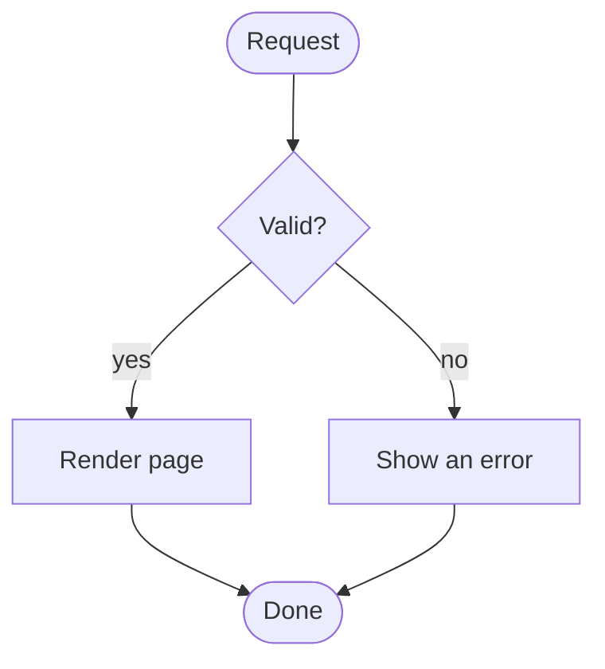

## Why this page exists

This page is a test bench. It collects the parts of Markdown that behave differently from plain paragraphs and checks them on narrow and wide screens.

### Nested structure

- First level
  - Second level
    - Third level with a [link](https://example.com/)
  - Second level again
- First level again

1. Step one
2. Step two
   - A detail
   - Another detail

> A quote can be longer than one line, and it still needs to stay readable at narrow widths.
>
> — A note to self

## Tables and long lines

| Column | Purpose | Example | Notes | More | Even more | Last |
| --- | --- | --- | --- | --- | --- | --- |
| First | Shows a short value | 42 | Keeps the row moving | Extra | Extra | End |
| Second | Shows a longer value | A sentence that takes space | Wraps nowhere because the table scrolls | Extra | Extra | End |
| Third | Another row | 7 | Short again | Extra | Extra | End |

A long link stays inside the text column: <https://example.com/notes/2026/10/a-very-long-path-that-should-wrap-without-breaking-the-layout/continued>

```js
const settings = { theme: "system", locale: "en", showNotes: true, pageSize: 10 };
const message = "This string is deliberately long so the code block has to scroll horizontally instead of stretching the page.";
console.log(message, settings);
```

## Diagrams



The next diagram is intentionally broken:

```mermaid
flowchart TD
  request([Request --> check{Valid?
```

When rendering fails, the source stays visible.

## The end

The last section exists to check the distance between a diagram, a heading and the footer.
