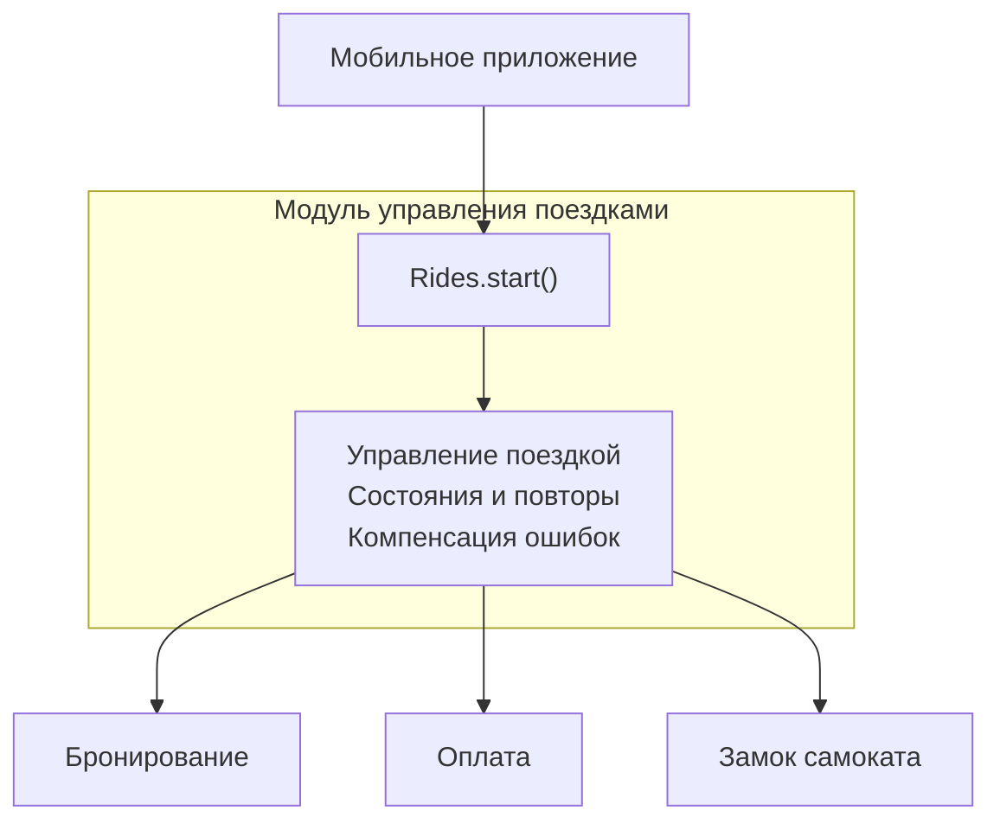

С кодинг-агентами довольно легко договориться о том, что нужно сделать, и гораздо сложнее — о том, как должна быть устроена сама программа.

Например, я могу попросить агента спроектировать систему, которую в будущем будет легко расширять. Но что я подразумеваю под расширяемостью? Возможность заменить отдельные компоненты? Изменить бизнес-логику? Независимо масштабировать части системы? А может, всё сразу?

Агент, конечно, что-нибудь придумает. Вопрос в том, насколько его представление о хорошей архитектуре совпадёт с моим.

Мне кажется, по мере того как написание кода всё больше переходит к агентам, умение **выражать инженерное намерение** становится самостоятельным навыком.

И здесь нам нужен какой-то промежуточный язык между обычной речью с её размытыми формулировками и конкретными архитектурными решениями. Такой, который позволял бы описывать желаемые свойства системы, не проектируя вручную каждую деталь.

## Есть один интересный скилл

Я слежу за творчеством Мэтта Покока, и меня особенно заинтересовал [codebase-design](https://www.skills.sh/mattpocock/skills/codebase-design) — по сути, небольшой словарь архитектурных понятий для общения с агентом.

Сами понятия хорошо известны. Любопытна идея собрать их в общий словарь, которым могут пользоваться и человек, и агент.

Попробуем на примере.

Допустим, мы проектируем сервис аренды электросамокатов. Чтобы начать поездку, нужно забронировать самокат, авторизовать платёж и разблокировать замок. За каждую операцию отвечает отдельная система.

На презентации всё выглядит замечательно: три прямоугольника, несколько стрелочек. Можно даже нарисовать облачко.

А потом клиент нажимает «Начать поездку», платёж проходит, замок открывается, но ответ от самоката теряется где-то в сети. Приложение считает, что поездка не началась. Клиент уже уехал. Впрочем, это ещё оптимистичный сценарий.

Вот здесь мне уже хочется поговорить с агентом об архитектуре.

## Насколько глубоким должен быть модуль?

У Покока есть понятие **module** — часть системы с собственным **interface** (интерфейсом) и **implementation** (реализацией).

Причём модулем может быть не только функция или класс, но и целая часть распределённой системы. А интерфейс включает не только методы, но и поведенческие гарантии.

Дальше появляется **depth** — глубина модуля. Хороший модуль предоставляет много полезного поведения через небольшой интерфейс.

В нашем случае я хочу, чтобы приложению было достаточно одного вызова:

```javascript
await rides.start({
  userId,
  scooterId,
  requestId
});
```

Здесь `requestId` позволяет серверу отличить повтор того же запроса от новой попытки начать поездку и избежать повторного выполнения операций.

А координация независимых систем, обработка сбоев и защита от дублирования должны оставаться внутри.



Конечно, сам вызов ещё не гарантирует, что замок открылся. Он может вернуть идентификатор поездки и промежуточный статус. Это тоже часть контракта.

Такая архитектура даёт два полезных свойства.

**Leverage** — сколько возможностей мы получаем, освоив интерфейс. **Locality** — насколько изменения остаются локальными. Если завтра изменится логика повторных попыток, мне не хочется переписывать мобильное приложение и всех остальных потребителей.

Но это отвечает на вопрос, каким должен быть хороший модуль. А как понять, нужен ли он вообще?

У Покока есть мысленный эксперимент — *deletion test*. Представим, что мы удаляем модуль, сохраняя функциональность системы. Если скрываемая им сложность расползается по остальному коду, модуль действительно был полезен. Если же исчезает только лишняя прослойка — возможно, она вообще не была нужна.

При этом глубокий модуль вовсе не обязан быть гигантским сервисом, который занимается всем на свете. Мне ближе идея собирать его из небольших, композиционно независимых частей. Глубина характеризует внешний интерфейс, а не внутреннее устройство.

## А если завтра придёт другой производитель?

Здесь пригодятся ещё два понятия: **seam** и **adapter**.

*Seam*, или шов, — место, где можно заменить поведение, не меняя использующий его код. Адаптер — конкретная реализация, подключаемая через этот шов.

Допустим, наш парк пополнили самокаты другого производителя. У них совершенно другой протокол управления замком.

Я хочу, чтобы система управления поездками об этом даже не узнала. Значит, между ней и оборудованием нужен шов, позволяющий подключать разные адаптеры.

Но если реализация одна и реальной потребности в заменяемости нет, дополнительный шов может оказаться лишним.

Мне нравится, что этот словарь позволяет обсуждать не только то, какие абстракции следует добавить, но и насколько они вообще оправданны.

## Я говорю с агентом

Теперь я могу сформулировать задачу примерно так:

> Мне нужен глубокий модуль управления поездками с минимальным внешним интерфейсом. Координация распределённых операций и обработка сбоев должны оставаться внутри. Повторные запросы не должны приводить к повторным списаниям или созданию нескольких поездок. Внутренние части должны сохранять композиционную независимость. Предусмотри швы там, где действительно нужна заменяемость, и объясни архитектурные компромиссы.

Конечно, из одной этой инструкции идеальная архитектура сама собой не получится.

Но здесь появляется важное отличие от привычного проектирования. Мне необязательно заранее выбирать конкретные паттерны, определять структуру компонентов и последовательность вызовов. Агент может самостоятельно предложить архитектуру, например с координацией распределённых операций и компенсацией ошибок, а мне остаётся оценить, насколько его решения соответствуют исходному намерению.

## Агент говорит со мной

Причём этот язык работает и в обратную сторону. Агент тоже может объяснять мне архитектуру через те же понятия, вместо того чтобы пересказывать содержимое десятков файлов.

Например:

> Я скрыл координацию распределённых операций за интерфейсом управления поездками. Выбрал последовательность локальных операций с компенсирующими действиями при сбоях. Для разных производителей замков выделил отдельный шов. При этом не стал вводить дополнительные интерфейсы для управления состояниями: пока это внутренняя часть модуля, которую не требуется заменять независимо.

Мне уже понятен общий смысл решения. Более того, я могу обсуждать с агентом его компромиссы, ещё не погружаясь в реализацию.

В некотором смысле это позволяет абстрагироваться и от технологического стека. В TypeScript, Go или Python одни и те же архитектурные задачи могут решаться разными средствами. Но за ними часто стоят общие идеи: сокрытие сложности, локальность изменений, заменяемость реализаций.

Получается, что общий словарь работает в обе стороны. **Человек выражает намерение, агент переводит его в архитектуру, а затем объясняет результат на том же языке.**

Именно эта двусторонность мне кажется особенно интересной.

## Вместо заключения

Все эти идеи существовали и раньше. Глубокие модули описывал Джон Остерхоут, понятие *seam* использовал Майкл Фезерс. Разработчики давно пользуются подобными концепциями, чтобы обсуждать архитектуру друг с другом.

Но с появлением кодинг-агентов у этого словаря возникает новая роль.

Раньше нам приходилось самостоятельно проходить весь путь от архитектурного намерения до конкретной реализации. Теперь значительную часть этого пути может пройти агент. А общие понятия позволяют человеку управлять процессом на более высоком уровне абстракции, не теряя возможности обсуждать принятые решения.

Разумеется, `codebase-design` пока сложно назвать полноценным языком моделирования. Но я думаю, что подобные словари — первые шаги к его появлению.

Возможно, со временем мы научимся описывать архитектуру набором достаточно точных понятий, ограничений и связей между ними. А агенты смогут самостоятельно находить реализации, удовлетворяющие этим требованиям, независимо от конкретных технологий.

Правда, остаётся одна проблема.

Агент может очень убедительно рассуждать о глубине модулей и правильно расположенных швах, а затем написать совершенно чудовищную архитектуру. И объяснить её теми же красивыми словами.

**Общий язык позволяет выразить намерение. Но он ещё не доказывает, что результат этому намерению соответствует.**

И вот здесь мы подходим к следующему вопросу — верификации архитектурных решений. Но это уже тема для отдельной статьи.

---

### Источники

1. **Matt Pocock** — [Codebase Design](https://github.com/mattpocock/skills/blob/main/docs/engineering/codebase-design.md). Архитектурный словарь и принципы проектирования глубоких модулей. Сам скилл доступен на [skills.sh](https://www.skills.sh/mattpocock/skills/codebase-design).
2. **John Ousterhout** — [A Philosophy of Software Design](https://web.stanford.edu/~ouster/cgi-bin/book.php), 2-е изд., 2021. Глубина модулей и управление сложностью.
3. **Michael Feathers** — *Working Effectively with Legacy Code*, 2004. Понятие *seam*. См. также [разбор Мартина Фаулера](https://martinfowler.com/bliki/LegacySeam.html).
4. **Chris Richardson** — [Pattern: Saga](https://microservices.io/patterns/data/saga.html). Координация операций и компенсация ошибок в распределённых системах.
