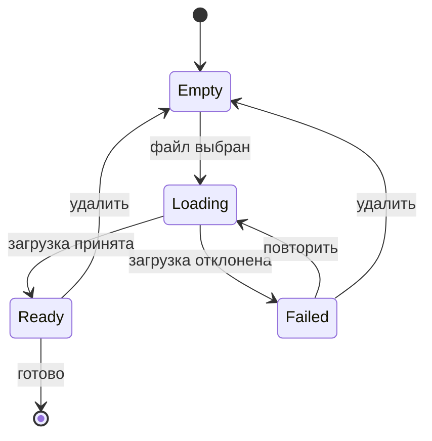

Первый черновик функции — почти никогда не код. Это короткое описание состояний: пусто, загрузка, готово, ошибка. Когда у них есть имена, коду есть куда расти.

Модель полезна, если отвечает на три вопроса: **что может произойти**, **кому это можно сделать** и **что увидит пользователь**. Остальное — детали.

## Начните с состояний, а не с экранов

Экраны — следствие. У формы загрузки файла одна и та же модель, живёт она в диалоге, на странице или в командной строке. Интересно другое: файл может *отсутствовать*, *загружаться*, *быть загруженным* или *отклонённым*, и интерфейс обязан говорить, что именно сейчас верно.

Выпишите состояния до того, как назовёте первый компонент:

- **Пусто** — ничего ещё не выбрано.
- **Загрузка** — система ждёт ответа.
- **Готово** — ответ пришёл, им можно пользоваться.
- **Ошибка** — ответ пришёл, но использовать его нельзя.

Четырёх строк хватает большинству функций. Если список продолжает расти, функция, скорее всего, делает больше одной работы.

### Одно состояние — один смысл

Состояние — не настроение. `Loading` не может одновременно значить «сохраняю» и «обновляю»: это разные обещания. Когда два смысла живут под одним именем, каждое условие вокруг них становится догадкой.

## Модель — это договор

Каждому состоянию нужен владелец. Владелец — не обязательно человек: это может быть запрос, таймер или фоновая задача. Важно, чтобы модель говорила, кто имеет право перевести систему из одного состояния в другое.

| Состояние | Что значит | Кто в него входит | Что видит пользователь |
| --- | --- | --- | --- |
| `empty` | Ввода ещё нет | Пользователь | Призыв к действию |
| `loading` | Ожидание результата | Пользователь или приложение | Сообщение о ходе работы |
| `ready` | Результат пригоден | Сервер | Результат и следующий шаг |
| `failed` | Результат непригоден | Сервер или сеть | Причину и путь назад |

Таблица нужна не ради документации. Это самая короткая форма, которая показывает пробелы: строку без владельца, состояние, из которого никто не выходит, сообщение, обещающее то, чего код не умеет.

## Нарисуйте переходы

Диаграмма оправдана, когда переходы важнее состояний. Для маленькой функции хватает списка. Если есть повторы, отмена или параллельные запросы, нарисуйте [конечный автомат](https://en.wikipedia.org/wiki/Finite-state_machine) до того, как писать обработчики:



Каждая стрелка — обещание. Если у стрелки нет подписи, модель неполная. Если у неё нет владельца, код придумает его сам.

## Назовите события до обработчиков

События — словарь модели. Держите их в прошедшем времени и делайте конкретными:

1. `fileSelected`
2. `uploadStarted`
3. `uploadAccepted`
4. `uploadRejected`
5. `fileRemoved`

Затем добавьте условия, которые легко забыть:

- повтор после `Failed` не должен создавать вторую загрузку;
- удаление файла во время `Loading` должно отменять запрос;
- поздний ответ на отменённый запрос нужно игнорировать, а не применять.

Каждое условие — тест, который ждёт своего часа. Модель подсказывает, где ему место.

## Сначала пропишите путь ошибки

Счастливый путь обычно самый простой. Путь ошибки решает, будет ли функция честной:

> Ошибка, которую интерфейс не может объяснить, — это не состояние ошибки. Это пропущенное состояние.

Когда ошибка случается, пользователю нужны три вещи: что произошло, в безопасности ли его работа и что делать дальше. Если модель не может дать эти три ответа, интерфейс заполнит пробел размытым текстом.

## Держите модель рядом с кодом

Модели не нужен собственный фреймворк. Небольшого объединения состояний и таблицы переходов достаточно, чтобы код оставался честным:

```ts
type UploadState =
  | { kind: "empty" }
  | { kind: "loading"; file: File }
  | { kind: "ready"; url: string }
  | { kind: "failed"; reason: string };

type UploadEvent =
  | { type: "fileSelected"; file: File }
  | { type: "uploadAccepted"; url: string }
  | { type: "uploadRejected"; reason: string };

function reduce(state: UploadState, event: UploadEvent): UploadState {
  if (state.kind === "empty" && event.type === "fileSelected") {
    return { kind: "loading", file: event.file };
  }
  if (state.kind === "loading" && event.type === "uploadAccepted") {
    return { kind: "ready", url: event.url };
  }
  if (state.kind === "loading" && event.type === "uploadRejected") {
    return { kind: "failed", reason: event.reason };
  }
  return state;
}
```

`reduce` намеренно скучная. Скучные переходы легко тестировать, а невозможный переход становится видимой веткой, а не скрытым допущением.

## Короткий чек-лист

Перед первым коммитом ответьте письменно:

- **Имена.** У каждого состояния есть имя, которое узнает пользователь?
- **Владельцы.** У каждого состояния есть владелец?
- **События.** У каждого перехода есть событие?
- **Выходы.** Из каждого состояния можно выйти, включая состояние ошибки?
- **Ошибки.** Каждая ошибка объясняет, что делать дальше?

Если вопрос остался без ответа, код ответит на него сам — только не там, где ответ можно проверить.

## Чего в модели нет

Модель — не спецификация каждого пикселя, и ей не стоит становиться вторым продуктом. Она описывает состояния, в которых система может находиться, и обещания между ними. Композиция, тексты и компоненты могут меняться, не трогая её.

В этом и смысл: когда модель ясна, коду остаётся меньше решений. А те решения, что остались, заслуживают внимания.
