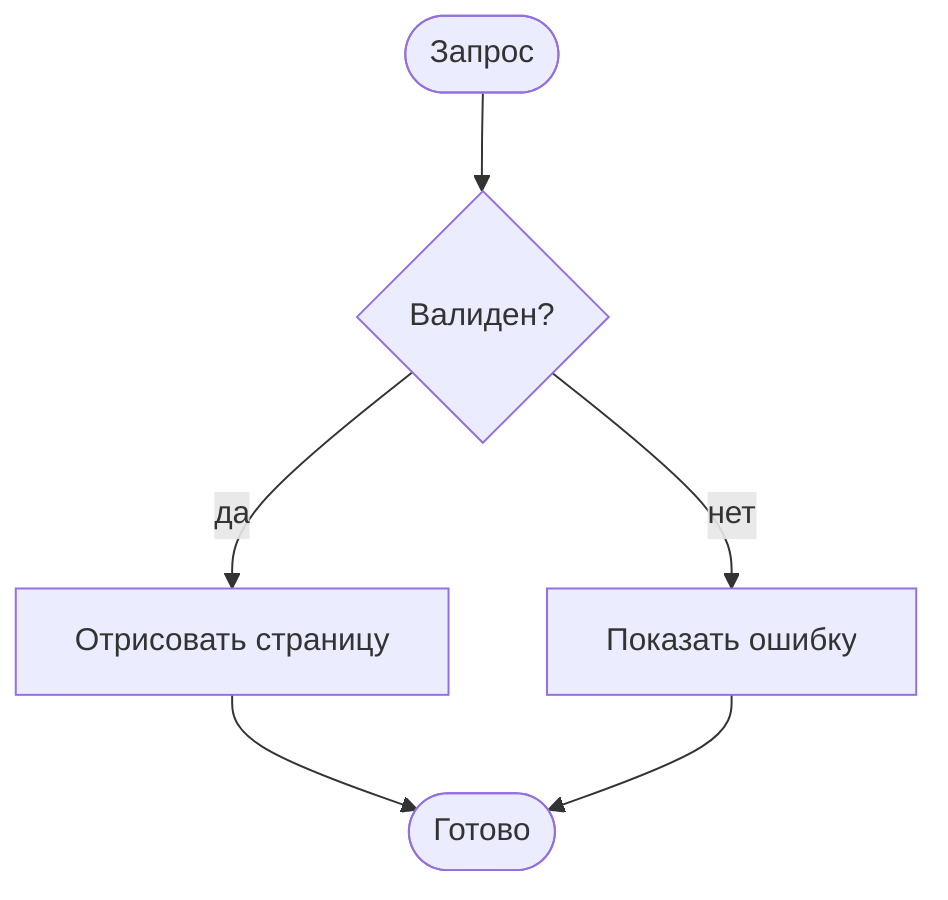

## Зачем эта страница

Это испытательный стенд. Здесь собрано то, что в Markdown ведёт себя иначе, чем обычный абзац, и проверяется на узких и широких экранах.

### Вложенная структура

- Первый уровень
  - Второй уровень
    - Третий уровень со [ссылкой](https://example.com/)
  - Снова второй уровень
- Снова первый уровень

1. Шаг первый
2. Шаг второй
   - Подробность
   - Ещё одна подробность

> Цитата может быть длиннее одной строки, и на узкой ширине она всё равно должна оставаться читаемой.
>
> — Заметка себе

## Таблицы и длинные строки

| Колонка | Назначение | Пример | Примечания | Ещё | И ещё | Последняя |
| --- | --- | --- | --- | --- | --- | --- |
| Первая | Короткое значение | 42 | Строка не тормозит | Ещё | Ещё | Конец |
| Вторая | Значение подлиннее | Предложение, которое занимает место | Не переносится, потому что таблица прокручивается | Ещё | Ещё | Конец |
| Третья | Ещё одна строка | 7 | Снова коротко | Ещё | Ещё | Конец |

Длинная ссылка остаётся внутри текстовой колонки: <https://example.com/notes/2026/10/a-very-long-path-that-should-wrap-without-breaking-the-layout/continued>

```js
const settings = { theme: "system", locale: "ru", showNotes: true, pageSize: 10 };
const message = "Эта строка нарочно длинная, чтобы блок кода прокручивался по горизонтали, а не растягивал страницу.";
console.log(message, settings);
```

## Диаграммы



Следующая диаграмма нарочно сломана:

```mermaid
flowchart TD
  request([Запрос --> check{Валиден?
```

Если отрисовка не удалась, исходник остаётся на экране.

## Конец

Последний раздел нужен, чтобы проверить расстояние между диаграммой, заголовком и футером.
